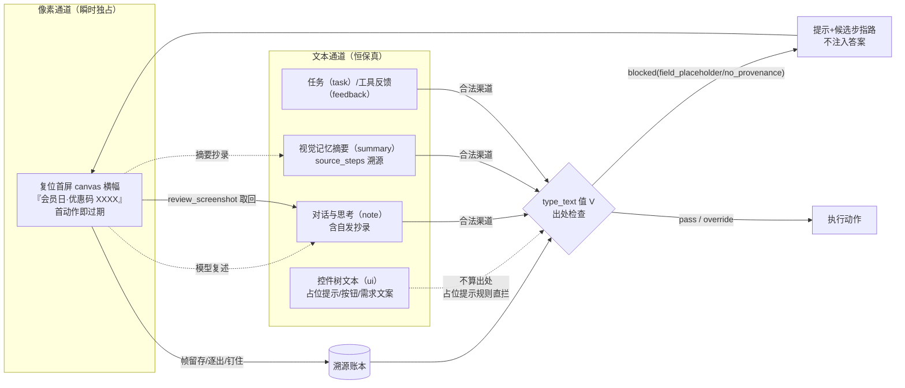
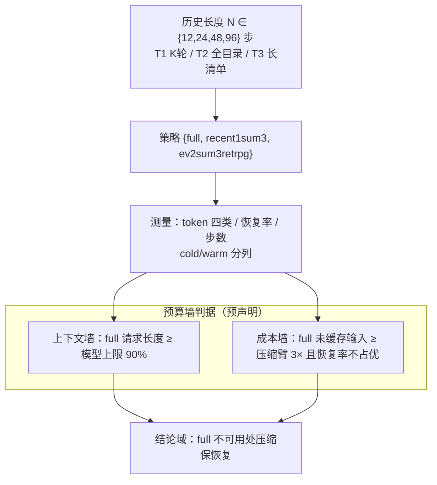

# 论文叙事骨架（2026-11-09）：计划假设 → 数据修正的诚实叙事

定位输入：[top-conference-plan-2026-11-06.md](top-conference-plan-2026-11-06.md)（路线与协议）、[provenance-gate-and-value-domain-2026-11-08.md](provenance-gate-and-value-domain-2026-11-08.md)（贡献边界与价值域口径）、[../research/EXECUTION-2026-11-06.md](../research/EXECUTION-2026-11-06.md)（批次证据链）。

题目暂定：**Preserving Recovery Evidence under Context Budgets for GUI Agents**（NeurIPS 2027 主目标，~2027-05 投出）。本文是写作骨架：主张-证据映射、诚实叙事线（计划假设被数据修正的八个点）、ECHOES 差异化素材、机制图。写作成稿时以本文为纲，数字以 EXECUTION 为准。

## 1. 主张-证据映射

| # | 主张（论文 claims） | 证据（批次） | 状态 |
|---|---|---|---|
| C1 | 瞬时像素独占线索（canvas 横幅）把「图像逐出丢证据」隔离为单通道可归因问题；文本通道恒保真作对照 | promo 机制 + 批 1（84）/批 2（60）/批 2b（24）：策略×故障交互干净成立（recent1 0/12） | 完成 |
| C2 | 恢复承载通路=摘要蒸馏（主）+ 显式取回（低频高效）；被动保留不承载；第四通路=自发抄录 | 批 3/4/5/6：蒸馏 11/12（修复前语义）、关键帧 1/12+0/12、取回自发 4/24（批 3）→ nudge 调后 8/12（8/8 成）；批 4 归因 41/47 摘要抄录+6/47 取回钉住+0 被动保留；批 5 自发抄录 3/12 | 完成 |
| C3 | **Provenance Gate（强形式）> nudge（弱形式）**：动作时刻确定性拦截无出处值，把失败转化为取证回路 | PG A/B 48 条：23/24 vs 16/24（7 胜 0 负 17 平，p≈0.0078，配对差 CI [0.167,0.417]）；机制链路 24/24、假触发 0、override 0 | 完成 |
| C4 | 价值域：full 历史在长任务撞预算墙（上下文 ≥90% 或成本 ≥3×），证据溯源压缩仍保恢复 | T1–T3 × 历史长度/预算曲线 | 跑中 |
| C5 | 规模与泛化：多种子 × 多实例 × 双故障族 + 聚类 bootstrap；第二 backbone；AndroidWorld | 2 种子×24 实例×c5 已有；统计工具已就位（stats_cluster.py） | 进行中 |

## 2. 诚实叙事线（八个数据修正点）

论文方法节按「计划假设 → 实测 → 修正」写，修正点全部有批次记录可引：

1. **方向门升级难度**（180 pilot）：三策略近天花板（98.6%），区分度不在成功率在成本结构 → 主动升级到瞬时线索机制（promo）。难度设计由数据驱动，不是先验挑简单题。
2. **被动保留不承载**：原直觉「多留几帧就能保住瞬时证据」被关键帧基线证伪（1/12+0/12）；承载者是蒸馏+取回。归因计数 0/47 被动保留。
3. **截断伪影与效度复核**（批 5→6）：M=6 失利 3 例含「固定 1200 输出上限 × 6 帧批量」截断混杂；recent1sum6b 放宽批量输出预算重跑——批 5 失利集 {i05,i07,i08} 全部复原、失败集换血 {i03,i12}。截断之外的**第二失效机制=内容遗漏**（预算充足仍丢瞬时横幅，2/12）。M≤3 工程结论不变，理由从「截断」扩展为「双失效」。教训：效度问题用复核分离两解，不靠事后解释。
4. **弱形式不够**（批 5 nudge A/B → PG A/B）：system 话术把取回自发 2/12→8/12、恢复 2/12→10/12，但失利机理单一（占位提示当答案→拼音垃圾，零取回）；同底座硬触发 23/24 vs 软提示 16/24。弱话术不改变行为模式，动作时刻确定性拦截才改变。
5. **PG 两次 gate miss（转录洗白）**（pg-preflight-1→3）：计划只预见「无出处=猜/幻觉」，未预见**思考抄屏幕文案成出处**（占位提示被转录后通过出处检查）。两度修正落在 producing boundary：渠道化出处（ui 不算）→ 占位提示字段语义规则（相等或片段，无视转录出处）。方法节诚实写：规则由实测失败通路驱动，含已知限制（占位内嵌建议词误拦一次走 override；拼音转写垃圾非字面规则范围）。
6. **i19 归因反转**：聚合时推测「幻觉码 R9AH」，ground truth 证实 R9AH 即真码（闸门全链路成功）；真实失利=research-env ANR。教训写进协议：**归因必须查 ground truth + UI dump，不得沿用聚合推测**。失败归因四分类：正确执行 / 闸门触发（占位、幻觉）/ 离机制模型失败 / 环境故障（ANR、崩溃）。
7. **A/B 环境公平性**：批 5 nudge 对照臂跑在旧 APK——无配对资格；recent1retrnudgeb 同参数新标签同环境重跑（沿用 recent1sum6b 先例）。配对实验的环境一致性是硬前提，宁可重跑不混环境。
8. **第四通路并入归因分类**：批 5 发现「自发抄录」（模型把横幅复述进对话文本，文本历史恒保真携带；3/12 无取回成功）——恢复通路分类从三路扩为四路：被动保留 / 显式取回 / 摘要蒸馏 / 自发抄录。
9. **环境就绪必须对账，固定等待不够**（长任务 preflight 感知竞态）：固定 sleep 的「app 就绪」假设被 t1r4s2g1 首屏截到桌面证伪——冷启动慢于等待，画布横幅从未入帧即被首动作过期，证据不可感知；竞态偶发（同批另一条完美捕获横幅），长历史任务对就绪更敏感。修复落在生产边界：复位「完成」=state.json episode_id 对账、app「可观测」=前台焦点确认；污染 episode 归档留证不静默重跑。协议教训写进方法节：**证据可感知性是环境层硬前提（就绪信号对账），感知竞态/ANR 归入环境故障类，与模型失败分列**。

## 3. ECHOES 差异化（related work 素材）

| 维度 | ECHOES（arXiv:2610.22408） | 本文 |
|---|---|---|
| 机制 | 训练期特权蒸馏（OPD-RL/GRPO），把「看过多图」的决策蒸馏进权重 | 免训练：运行时证据账本 + 摘要蒸馏（source_steps 溯源）+ 取回工具 |
| 部署态像素 | 丢弃，不可取回 | 本地留存帧可回看取证（review_screenshot） |
| 错误恢复 | PMF 缺口即永久（错误状态无法修复） | 可重观察、可纠错；动作时刻 Provenance Gate 闭环 |
| 模型前提 | 需训练权重 | 冻结权重 API 模型即可用 |
| 测量 | PMF 保真缺口 | 恢复率 + 通路归因 + 预算墙曲线 + 强弱形式 A/B |

Positioning 要点（英文写作素材）：ECHOES shows history screenshots are training-time privileged information and distills multi-image decisions into weights—but at deployment the pixels are gone and an incorrect state is unrecoverable. We keep the evidence instead of compressing it away once: a provenance ledger (raw frames retained, summaries carry source steps) plus explicit retrieval makes recovery possible under context budgets, and a provenance gate closes the loop at action time—no training, frozen weights, any API model.

## 4. 机制图

图 1——证据通路与闸门（方法）：

图 2——价值域预算墙（动机，坐标为示意，实测点待曲线批次）：

## 5. 顶会差距 checklist（对照 2026-11-08 评估）

- [x] 机制创新：Provenance Gate 闭环（免训练/可取回/冻结权重）+ 两次实测修正的诚实设计链
- [x] 强弱形式 A/B + 消融（批 4 四臂 + 批 5/6 M 曲线 + PG A/B）
- [x] 统计工具（配对符号检验 + 任务族聚类 bootstrap）双数据集验证
- [ ] **价值域曲线（T1–T3，跑中）**——命门实验，C4 的唯一证据
- [ ] 3 种子全量（含 PG 最优臂）+ 聚类统计成稿
- [ ] 第二 backbone（同协议换模型）
- [ ] AndroidWorld 泛化（阶段 F）
- [ ] 写作成稿（本文为纲；机制图定稿、图表渲染）

时间线（不变）：12 月内曲线+多种子 → 1 月第二 backbone → 2–3 月 AndroidWorld → 4 月写作 → 5 月投 NeurIPS 2027。
